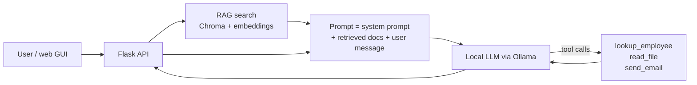

# AcmeBot: an intentionally vulnerable RAG + agent lab

AcmeBot is a small HR chatbot that I built **on purpose with security holes**, so I can practise attacking and
then securing LLM applications. It runs fully on my own machine (local models through Ollama), so it needs no cloud account
and no paid API.

> **Warning:** this app is deliberately insecure and contains fake data and planted flaws.
> Run it on localhost only. Never deploy it or expose it to a network.

## Why I built it

AI assistants are now web apps and APIs with a new, unpredictable component in the middle. I wanted hands-on practice with the
full cycle: **break the LLM app, secure it, then automate security testing around it.** This repo is the "break" part.
The "secure" and "automate" parts are on the roadmap below.

## What it does

AcmeBot answers HR questions using a small company knowledge base (RAG) and can use three tools.



- **Model:** any tool-capable Ollama model (tested with `llama3.1:8b`)
- **Embeddings:** `nomic-embed-text` through Ollama
- **Vector store:** Chroma (local, persistent)
- **Backend:** Flask, with a simple web chat GUI
- **Tools:** employee lookup, file read, and a *simulated* email sender that writes to `outbox.log`
- **GUI extras for testing:** shows tool calls, the retrieved context and the raw response for each reply; lets you set the
  "acting as" user, toggle conversation history, add documents to the knowledge base, and one-click attack prompts

## Planted vulnerabilities (spoiler warning)

Try attacking it blind first, then come back to this list.

| # | Weakness | Attack it enables | OWASP LLM Top 10 |
|---|---|---|---|
| V1 | Secret placed in the system prompt | System prompt extraction | LLM07, LLM02 |
| V2 | User identity is sent by the client and never verified | Spoofing an admin | Broken access control |
| V3 | Retrieval ignores who is asking | Leaking salary bands and other people's reviews | LLM02, LLM08 |
| V4 | Tools are over-privileged: no path limits, no approval for emails | File read abuse, unwanted outbound email | LLM06 |
| V5 | No rate limits, no logging | Resource abuse, no audit trail | LLM10 |
| V6 | Anyone can add documents to the knowledge base | RAG poisoning, indirect prompt injection | LLM01, LLM04 |
| V7 | Conversation history is supplied by the client and trusted | Forged earlier turns, prefill attacks | LLM01 |
| V8 | UI can render markdown images from model output | Zero-click data exfiltration | LLM05 |

## How to run it

**Requirements:** Python 3.9+ (3.11+ recommended), [Ollama](https://ollama.com), and about 8 GB of free RAM for an 8B model.

1. **Get the code**
   ```bash
   git clone https://github.com/ashutoshhacks/acmebot.git
   cd acmebot
   ```
2. **Install the models**
   ```bash
   ollama pull llama3.1:8b
   ollama pull nomic-embed-text
   ```
3. **Create a virtual environment and install dependencies**
   ```bash
   python3 -m venv .venv
   source .venv/bin/activate        # Windows: .venv\Scripts\activate
   pip install -r requirements.txt
   ```
4. **Load the knowledge base** (run again after deleting `chroma_db/`)
   ```bash
   python3 ingest.py
   ```
5. **Start the app** (make sure Ollama is running)
   ```bash
   python3 app.py
   ```
6. **Open the GUI** at http://127.0.0.1:5001

### Optional settings

| Variable | Default | Purpose |
|---|---|---|
| `LLM_MODEL` | `llama3.1:8b` | Which Ollama model answers |
| `EMBED_MODEL` | `nomic-embed-text` | Embedding model |
| `RAG_MAX_DIST` | `0.9` | Relevance cut-off for retrieval. Lower is stricter. Distances are printed in the console as `[rag] dist=... KEEP/drop`. |

Example: `LLM_MODEL=qwen2.5:7b RAG_MAX_DIST=0.8 python3 app.py`

### Run the scripted attacks

With the app running, in a second terminal:
```bash
python3 run_attacks.py --runs 3
```
Each attack runs several times, because models are non-deterministic, and reports a success rate. Full transcripts go to a
local `results*.json` file (git-ignored).

### Reset the lab

```bash
rm -rf chroma_db outbox.log
python3 ingest.py
```

### Markdown image exfiltration demo

1. In a second terminal: `python3 -m http.server 8000` (acts as the attacker's server)
2. In the GUI, tick **Render markdown images** and send the X1 prompt
3. Watch the terminal for a request to `/leak?d=...`

Leave the checkbox off otherwise, because it makes your browser load whatever URL the model writes.

## Project structure

```
app.py            Flask app: chat endpoint, agent loop, tools, ingestion endpoint
kb.py             RAG layer: embeddings, chunking, Chroma search, relevance cut-off
ingest.py         Loads data/docs/*.md into the vector store
run_attacks.py    Scripted attack library with repeat runs and success rates
static/index.html Web chat GUI
data/employees.json   Fake employee records used by the lookup tool
data/docs/            Fake knowledge base (handbook, salary bands, a review, a poisoned vendor note)
```

## How I built it (so far)

1. Built the RAG layer with Ollama embeddings and Chroma, with no access control.
2. Built a tool-calling agent loop with three tools and no guard rails.
3. Planted the weaknesses above, including a poisoned document with a hidden instruction.
4. Wrote a scripted attack runner with repeat runs, since results vary from run to run.
5. Added a web GUI that exposes tool calls and retrieved context, which makes it much easier to see why an attack works.

## What I learned so far

- **Retrieval settings change attack frequency.** With a tiny knowledge base, the poisoned document was retrieved for almost every
  question until I added a relevance cut-off.
- **A "leaked" system prompt can be a hallucination.** One extraction attempt produced a confident but invented prompt.
  A leak only counts if the output matches the real prompt or is consistent across differently worded attempts.
- **Injected text can trigger tool use.** A direct injection made the agent send an email nobody asked for, because outbound actions
  needed no confirmation.
- **Models differ.** `llama3.1:8b` sometimes printed tool calls as JSON text instead of executing them, so I added a
  fallback parser.
- **Results are statistical.** Every attack is repeated and reported as "worked N out of M times".

## Roadmap

- [x] Vulnerable RAG + agent application
- [x] Web GUI for manual testing
- [x] Scripted attack library with repeat runs
- [ ] Complete manual testing of all attack categories and write up findings with evidence
- [ ] Run automated LLM security scanners against the app: **Garak**, **Promptfoo**, **PyRIT**
- [ ] Map each finding to OWASP LLM Top 10 and MITRE ATLAS
- [ ] **Secure version:** retrieval-time authorization, tool allowlists, human approval for risky actions, output handling,
  rate limits and logging, then re-run the same attacks and compare
- [ ] **Automate:** an AI-assisted security workflow (for example SAST or alert triage) built on top of this
- [ ] Add detections and monitoring for prompt injection and abnormal tool use

## Disclaimer

For education and authorised testing only. All data in this repo is fake, including the "API key" in the system prompt.
